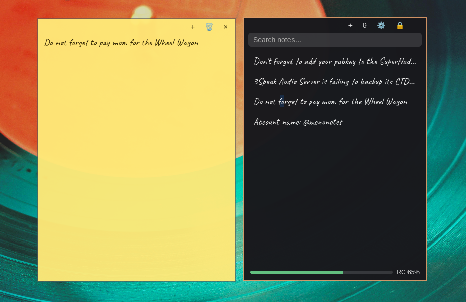

# Stickit



Floating, see-through sticky notes for Linux (built for [Omarchy](https://omarchy.org) and
Hyprland), encrypted on your machine, with optional backup and sync through the
[Hive](https://hive.io) blockchain and a phone-friendly web app (PWA) that reads the same notes.

- **Private by default.** Notes are encrypted with a key only you hold. Nothing is readable
  without your passphrase, on disk or on-chain.
- **No server to run, no account to create with us.** Backup goes to a Hive account you own.
  [Why Hive?](docs/why-hive.md)
- **Your notes everywhere.** The desktop app and the PWA sync through Hive. Write on your phone,
  find it on your desktop a minute later.
- **Lives in the tray.** Closing a window hides it; the app keeps running.

| Part | What it is | Where |
|------|-----------|-------|
| Desktop app | Tauri app: notes list, floating note windows, tray, vault, Hive sync | `src/`, `src-tauri/` |
| PWA | Browser/phone client, joins the vault you made on the desktop | `pwa/` ([guide](docs/pwa.md)) |
| Omarchy widget | Bar button: click to show/hide notes, middle-click for a new note | `omarchy-plugin/` |
| Shared code | Hive sync engine and the web port of the crypto | `shared/` |

## Install the desktop app

Requirements: Rust, Node.js 20+, and the
[Tauri Linux prerequisites](https://tauri.app/start/prerequisites/#linux) (WebKitGTK and friends).
On Windows, use the [Tauri Windows prerequisites](https://tauri.app/start/prerequisites/#windows)
instead (see [Windows](#windows) below).

```sh
git clone <this repo> stickit && cd stickit
npm install
npm run tauri build
```

The binary is `src-tauri/target/release/stickit` (installable bundles are under
`src-tauri/target/release/bundle/`). Put it on your `PATH`, for example:

```sh
install -Dm755 src-tauri/target/release/stickit ~/.local/bin/stickit
```

To try it without building a release: `npm run tauri dev`.

### Other platforms

Linux, macOS and Windows all build from the same source. Pushing a `v*` tag runs
`.github/workflows/release.yml`, which attaches `.deb`, `.rpm`, AppImage and `.dmg`
installers to a draft release. The macOS build is unsigned, so Gatekeeper warns on
first launch. Linux and macOS have been tested. Windows runs from source but installers aren't
published yet (see [issue #1](https://github.com/menobass/stickit/issues/1)).

### Windows

Tested on Windows 11 with `npm run tauri dev`. You need:

- Visual Studio 2022 (or its Build Tools) with the **Desktop development with C++** workload,
  *including a Windows 10/11 SDK*. Without the SDK, linking fails with "`link.exe` not found".
- The WebView2 runtime (already installed on Windows 10 and 11).

Build from PowerShell or `cmd`, not Git Bash: Git Bash puts its own `link.exe` (a file-linking
tool) ahead of the MSVC linker on `PATH`, and the build fails with "link: extra operand". If
cloning fails with "Filename too long", run `git config --global core.longpaths true` or clone
to a shorter path.

### Make notes float (Hyprland)

Stickit draws its own transparency, so tell Hyprland to float the windows and not dim them a
second time. On Omarchy, create `~/.config/hypr/stickit.lua`:

```lua
-- Stickit: floating, see-through sticky notes. The app draws its own transparency,
-- so opt out of Omarchy's default opacity to avoid double-dimming.
o.window("^stickit$", { float = true, tag = "-default-opacity" })
```

and add `require("hypr.stickit")` to `~/.config/hypr/hyprland.lua`. (This is the same content as
`hyprland-rules.lua` in this repo.) On Wayland, apps can't choose their own position, so note
windows open where Hyprland puts them; their sizes are remembered.

### Autostart

Add `stickit` to `~/.config/hypr/autostart.lua` (or your usual autostart) so the tray icon is
there after login.

## First run

1. Click the tray icon to open the list. Choose a **passphrase** (8+ characters; four unrelated
   words is easy to remember and hard to crack).
2. **Write down the 24 recovery words** shown once. They are the only way back in if you
   forget the passphrase. Nobody, including this project, can reset it.
3. Press **+** for a note. Notes save as you type.

## Back up and sync with Hive

1. Create a **dedicated Hive account** for notes (don't reuse your main one).
2. In Stickit press ⚙, enter the username and its **posting key** (never owner/active/memo; the app
   refuses those), then **Connect**.
3. Press **Sync now**, or leave **Auto-sync** on: edits are sent about two minutes after you stop
   typing, and the app checks for changes from other devices every minute.

Each note you back up spends a little of the account's *Resource Credits*. New accounts have very
few; see [Why Hive?](docs/why-hive.md#resource-credits) for what that means and how to get more.

## Use it from your phone or another computer

Build and host the PWA, sign in with the account and the vault passphrase, and your notes appear.
See [docs/pwa.md](docs/pwa.md).

## Omarchy bar widget

Install the widget from its own repo (see [omarchy-plugin/README.md](omarchy-plugin/README.md)):

```sh
omarchy plugin add <url of the omarchy-plugin repo> --enable
```

## Command line

Stickit is a single-instance app. Running it again talks to the running copy:

| Command | Does |
|---------|------|
| `stickit` or `stickit --toggle` | show or hide the notes list (starts the app if needed) |
| `stickit --new` | new note (or the list, if the vault is locked) |

Bind these to a Hyprland key if you like.

## More

- [Why Hive? What it costs, what it means](docs/why-hive.md)
- [Security model and its limits](docs/security.md)
- [The PWA](docs/pwa.md)

## Development

```sh
npm run tauri dev     # desktop app with hot reload
npm run pwa:dev       # PWA on http://localhost:5180
npm run pwa:build     # PWA static files in pwa/dist
npx tsc --noEmit      # type-check the desktop app (use `npx tsc -p pwa` for the PWA)
cargo test --manifest-path src-tauri/Cargo.toml
```

Your data lives in `~/.local/share/dev.meno.stickit/stickit.db`, or
`%APPDATA%\dev.meno.stickit\stickit.db` on Windows (encrypted note bodies; the vault's wrapped
keys; the sealed Hive posting key).

## License

[MIT](LICENSE)
